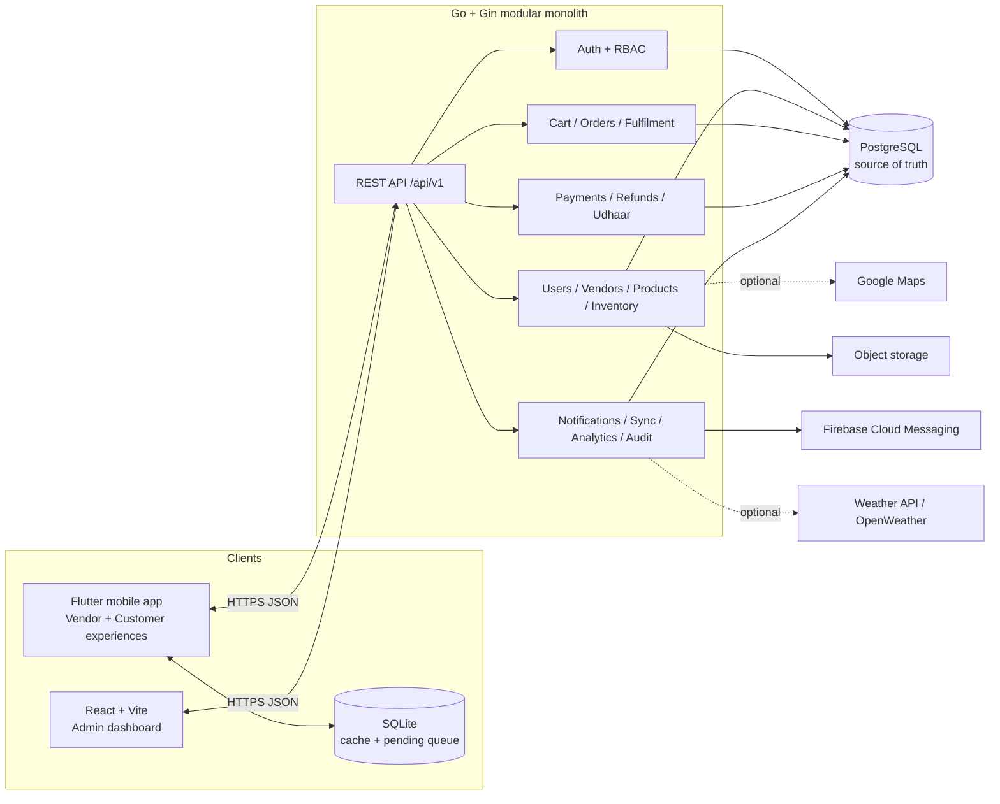
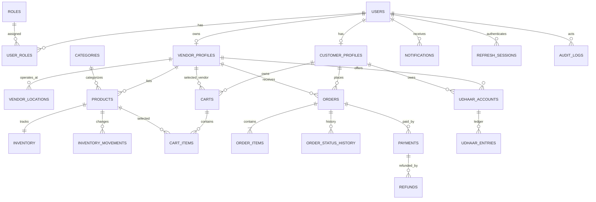
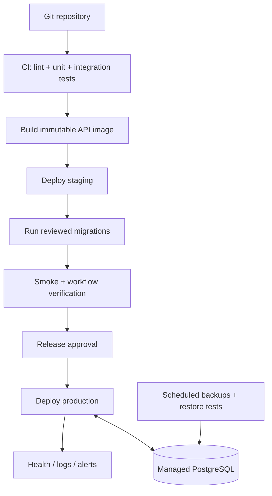

# VendorSaathi — Software Architecture Specification

**Document version:** 1.0  
**Date:** 6 November 2026  
**Status:** Proposed implementation baseline; business decisions listed in §28 remain open  
**Source:** VendorSaathi project presentation (19 slides, dated 16 October 2026, with later slide footer dates) and the supplied architecture brief  
**Audience:** Product owners, backend/mobile/web developers, testers, deployment operators, and AI coding agents  

> **Authority rule:** This document is the implementation source of truth for the MVP. The presentation establishes product intent and confirmed scope; this document adds engineering decisions to make that scope buildable. Where a decision is provisional, it is labelled. Do not silently convert an assumption into a product requirement.

## 1. Document purpose and use

VendorSaathi connects nearby customers with local and mobile vendors. It digitizes vendor profiles, products, inventory, orders, fulfilment, payment records, Udhaar (credit) and basic sales summaries. The system consists of one Flutter application with Vendor and Customer experiences, a separate React administration dashboard, and a Go/Gin REST API backed by PostgreSQL. SQLite is device-local storage for cached information and explicitly supported queued operations; it is not authoritative.

This specification defines the MVP boundary, module responsibilities, data model, API conventions, workflows, transaction guarantees, security controls, deployment approach, tests, and implementation sequence. Developers and coding agents must:

1. Read this document before changing code or schema.
2. Implement one vertical slice at a time and keep client, API, schema, and tests consistent.
3. Treat **Confirmed**, **Architecture Decision**, **Assumption**, and **Client Decision Required** labels literally.
4. Stop and ask for a product decision when an unresolved choice changes user-visible behaviour or financial semantics.
5. Record an approved deviation in an architecture decision record (ADR), update this document, and only then implement it.

### 1.1 Classification key

- **Confirmed:** Explicitly shown in the presentation or supplied as an approved stack/constraint.
- **Architecture Decision (AD):** Engineering choice made here to deliver the confirmed product safely.
- **Assumption (A):** Provisional product behaviour selected because the source material is incomplete.
- **Client Decision Required (CDR):** Must be confirmed by the project owner before the affected functionality is finalized.

### 1.2 Architecture principles

- Modular monolith first; no microservices for the MVP.
- PostgreSQL is the only cloud source of truth.
- Financial and inventory changes are server-authoritative, transactional, auditable, and idempotent where retries are possible.
- Keep handlers thin, services responsible for business rules, and repositories responsible for persistence.
- Use constructor-based dependency injection; avoid mutable package globals.
- Make offline capability explicit and bounded. Never imply a queued operation has been accepted by the server.
- Enforce authorization in the backend, including ownership checks.
- Prefer a small, testable implementation over speculative infrastructure.

### 1.3 Terminology

| Term | Meaning |
|---|---|
| Vendor | A registered user operating a local/mobile business through VendorSaathi. |
| Customer | A user discovering vendors and placing orders. |
| Admin | Authorized platform operator using the web dashboard. |
| Udhaar | Vendor-managed customer credit/debt recorded as an append-only ledger. |
| On-hand | Physical quantity currently recorded for an inventory item. |
| Reserved | Quantity committed to active orders but not yet fulfilled/released. |
| Available | `on_hand - reserved`; quantity eligible for a new reservation. |
| Fulfilment | Customer pickup or delivery performed by the vendor. |
| Source of truth | The authoritative persisted value; for shared business data this is PostgreSQL. |
| MVP | First usable release limited to the capabilities in §2.4. |

## 2. Product definition and scope

### 2.1 Problem and intended solution

The presentation identifies four problems: manual records for products, stock, orders, payments and Udhaar; conventional apps being difficult for small vendors, particularly users more comfortable with Kannada/regional languages; vendors travelling to similar locations without demand awareness; and customers being unable to reliably find nearby vendors, inspect availability or track orders.

VendorSaathi proposes a simple local-commerce platform. The immediate solution digitizes the operational workflow and customer-vendor connection. A voice-first interface, AI-driven demand awareness and intelligent mobility are part of the broader title/product direction, but the presentation's explicit MVP capability lists and use-case/requirements diagrams centre on conventional catalogue, ordering, inventory, payment, Udhaar, notification and administration workflows.

### 2.2 Target users and value

- **Vendors:** Maintain a business profile, catalogue and stock; accept/reject orders; prepare and fulfil orders; record cash/verified UPI payments; maintain Udhaar; view sales summaries.
- **Customers:** Discover nearby vendors, browse products, manage a cart, choose pickup or vendor delivery, place orders, view order history/status and receive notifications.
- **Admins:** Oversee platform activity, manage users/vendors, suspend/reactivate accounts, inspect audit history and manage administrative permissions.

### 2.3 Product vision versus MVP

The product title is “AI-Driven Voice Commerce & Intelligent Mobility Platform for Vendors.” The presentation's problem statement also calls out demand awareness and regional-language usability. However, its detailed MVP slides specify a Flutter app, React admin, Go/Gin backend, PostgreSQL, SQLite, FCM, maps/weather and object storage. No concrete voice command grammar, speech provider, demand-prediction data model, optimization objective, or mobility dispatch workflow is supplied.

Therefore:

- **MVP:** Deliver reliable local discovery, vendor/product/inventory management, cart/checkout, order lifecycle, pickup/vendor delivery, cash and manually verified UPI records, split payments, Udhaar ledger, notifications, basic summaries, admin oversight, and bounded offline caching/sync.
- **Deferred pending specification:** Voice commerce, AI recommendations/demand forecasting, automated mobility/route optimization, live rider tracking, automated payment gateway collection, and a separate rider network. Preserve extension points but do not build speculative versions of these features.

### 2.4 MVP feature classification

| Priority | Features |
|---|---|
| Must Have | One Flutter app; role-based Vendor/Customer experiences; authentication; vendor profile/location; product CRUD and images; inventory and adjustment history; nearby vendor discovery; product browsing; cart; online checkout; stock reservation; pickup/vendor-delivery selection; order status/history; cash and manually verified UPI payment records; split payments as multiple payment records; Udhaar ledger; push/in-app notification records; basic vendor sales summary; React admin authentication/RBAC; user/vendor management; suspend/reactivate; audit history; PostgreSQL; SQLite read cache and safe supported operation queue; Dockerized Go API. |
| Should Have | Kannada-ready localization framework and translated MVP strings; search/filter improvements; admin operational filters; configurable business hours; weather context if a real use case is approved; richer analytics within available data; CSV export if explicitly needed. |
| Deferred | Voice assistant/speech ordering; ML demand prediction; AI-generated product content; route optimization; real-time vendor/rider tracking; rider role/dispatch; automatic payment gateway; multi-vendor cart; advanced geospatial infrastructure; Redis/Kafka/microservices. |

### 2.5 Product requirements traceability

| Presentation evidence | Architecture treatment |
|---|---|
| Slides 3, 5, 6: one Flutter app for Vendor and Customer; separate React admin | §3, §4, §5 |
| Slides 3, 6: vendor profiles, products, inventory | §8, §9, §10, §11 |
| Slides 3, 6: discovery, cart, checkout, order history | §8, §12 |
| Slides 3, 6: pickup or vendor delivery | §12.4 |
| Slides 3, 6: cash, verified UPI, split-payment records | §13 |
| Slides 3, 6: Udhaar, notifications, sales summaries | §14–§16 |
| Slides 3, 5, 6: SQLite cache/sync; PostgreSQL source of truth | §7, §17 |
| Slide 4: Kannada/regional-language usability | localization requirement; exact launch languages are CDR-01 |
| Slide 4: lack of demand awareness | future product capability; no measurable MVP requirement supplied |
| Slide 7: FCM, Google Maps + OpenWeather, object storage | §18; integrations are isolated and optional when not required for core flow |
| Slide 8: modular Go/Gin REST backend, PostgreSQL, external services | §3 and §5 |
| Slide 9: requirements → design → backend/mobile/admin → offline → testing → deployment | §25 |
| Slide 11: Vendor, Customer, Admin use cases | §4 and module/API sections |
| Slide 12: users/vendors/customers/products/orders/items/payments/refunds/inventory/Udhaar/support tables | §6 |
| Slides 13–14: usability, reliability, offline, security, data integrity, performance, maintainability, privacy | §19 and §20 |
| Slide 15: validate stock → reserve/create order transaction → commit → notify; cancellation/rejection release stock once | §12.2 and §21 |
| Slide 17: role-based app, order workflow, flexible fulfilment, cloud/local data, admin oversight | MVP acceptance criteria throughout |

## 3. Approved technology baseline

| Technology | Purpose | Used in | Reason / implementation notes | Classification |
|---|---|---|---|---|
| Flutter + Dart | Cross-role mobile app | Android/iOS app | Single application with role-gated experiences | Confirmed |
| Riverpod | State/dependency management | Flutter | Consistent feature-level providers; keep business logic out of widgets | Confirmed by supplied brief |
| SQLite | Device cache and operation queue | Flutter | Selected offline reads and queueable changes only | Confirmed |
| React + Vite | Admin dashboard | Web | Separate admin surface | Confirmed |
| Go | Backend language | API | Typed, maintainable modular monolith | Confirmed |
| Gin | HTTP routing | API | REST API framework | Confirmed |
| PostgreSQL | Cloud relational source of truth | Backend | Constraints, transactions, row locks, auditability | Confirmed |
| JWT access + refresh tokens | API authentication | API/mobile/admin | Short-lived access, rotating refresh tokens | Confirmed |
| Firebase Cloud Messaging | Push notifications | Backend/mobile | Delivery channel, not source of business truth | Confirmed |
| Google Maps | Maps/location display | Mobile/backend as needed | Nearby discovery and map display where enabled | Confirmed |
| OpenWeather / Weather API | Weather context | Integration adapter | Slide 7 specifically names OpenWeather; no core business rule depends on it | Confirmed as reference, use CDR before product use |
| Object storage | Product images/files | Backend/mobile | Binary files outside PostgreSQL; metadata/keys in DB | Confirmed |
| Docker | Repeatable deployment | Backend/local environment | Containerized API and local dependencies | Confirmed by supplied brief |
| SQL migration tool | Versioned schema changes | Backend | **AD:** choose one tool (e.g. golang-migrate) and pin version; do not mix tools | AD |
| PostgreSQL driver/query layer | Database access | Backend | **AD:** use pgx; use explicit SQL or sqlc only if team adopts it consistently | AD |
| Flutter secure storage | Refresh token storage | Mobile | **AD:** platform secure storage; never store refresh token in plain SQLite/preferences | AD |
| React Router + query/cache library | Admin routing/data fetching | Admin | **AD:** select stable maintained packages; avoid redundant global state | AD |

Do not add Redis, Kafka, Firestore, a second cloud database, microservices, or PostGIS for the MVP. A dependency must have a concrete requirement, owner, operational cost and test plan before introduction.

## 4. Roles, identity and authorization

### 4.1 Roles

- **CUSTOMER:** discover public vendors/products, manage own cart/orders, view own payment/order history, receive own notifications.
- **VENDOR:** manage only owned vendor profile, catalogue, inventory, orders, payments, Udhaar accounts and vendor summaries.
- **ADMIN:** manage platform users/vendors, inspect platform activity and take permitted operational actions.
- **SUPER_ADMIN:** manage admin permissions and other high-impact platform configuration. **A:** include this role only if the project owner confirms a separate privilege tier; otherwise ADMIN is the highest role with narrowly defined permissions.

A user identity is separate from a vendor business profile. This allows the system to support more than one profile or role later without duplicating login credentials. Whether one account can simultaneously act as Customer and Vendor is CDR-01.

### 4.2 Permission matrix

| Capability | Customer | Vendor (own vendor only) | Admin | Super Admin |
|---|---:|---:|---:|---:|
| Read public vendor/product listing | Yes | Yes | Yes | Yes |
| Edit own customer profile/addresses | Yes | If customer profile enabled | Support-limited | Yes |
| Create/edit vendor profile | No | Own profile | Yes, support action | Yes |
| Manage products and stock | No | Own vendor | Support/override, audited | Yes |
| Place/view own orders | Yes | Only if separately acting as customer | Read/support as permitted | Yes |
| Accept/reject/fulfil vendor orders | No | Own vendor | No routine fulfilment | Exceptional support only |
| Record payment/Udhaar | Own payment evidence only if supported | Own vendor | Read/adjustment only with reason | Yes, audited |
| View vendor sales summary | No | Own vendor | Platform-level aggregates | Yes |
| Suspend/reactivate user/vendor | No | No | Yes, permission-gated | Yes |
| Manage admin permissions | No | No | No | Yes |
| Read audit events | Own relevant events only if exposed | Own relevant events only if exposed | Yes, scoped | Yes |

### 4.3 Backend enforcement

1. Authentication middleware validates signature, issuer/audience, expiry and token type.
2. Authorization middleware checks coarse role/permission.
3. Service-level policy checks resource ownership on every ID-bearing operation. Example: `order.vendor_id` must belong to the authenticated vendor; customer reads require `order.customer_id == actor.user_id`.
4. Repository queries should include tenant/owner predicates where practical; do not fetch an arbitrary record and rely only on UI hiding.
5. Client-supplied `role`, `vendor_id`, payment status, stock, price or balance is never authoritative.
6. Admin override actions require a permission, a reason, and an audit record.

## 5. System architecture

### 5.1 Logical architecture



### 5.2 Component ownership

- Flutter owns presentation, local interaction state, secure token handling, local cache and queued-operation UX. It does not own authoritative stock, order, payment or Udhaar calculations.
- React admin owns platform administration screens and client-side route gating. It does not own admin authorization.
- Go API owns validation, authorization, business rules, transaction orchestration, integration adapters and response contracts.
- PostgreSQL owns all shared business records and durable audit history.
- SQLite stores explicitly cached projections and pending operations for one device/user context.
- FCM transports minimal push payloads. The app fetches current state from the API.
- Object storage owns image/file bytes; PostgreSQL stores object key, content metadata and ownership.

### 5.3 Request lifecycle

`HTTPS Request → request ID / recovery / CORS / rate limit → access-token authentication → role/permission and ownership checks → handler DTO validation → service business rules → repository transaction/query → PostgreSQL → response DTO`.

Handlers translate HTTP to application calls and must not implement business workflows. Services receive `context.Context`, dependencies and validated input. Repositories accept context and perform parameterized SQL. External calls are isolated behind adapters and must not be made while holding database locks unless unavoidable.

### 5.4 Authentication flow

```mermaid
sequenceDiagram
  participant C as Flutter / Admin
  participant API as Go API
  participant DB as PostgreSQL
  C->>API: POST /auth/login (credentials)
  API->>DB: Find active user + password hash
  DB-->>API: User + roles
  API->>API: Verify password; create refresh session
  API->>DB: Store hashed refresh token/session
  API-->>C: Short-lived access JWT + refresh token
  C->>C: Store refresh token securely
  C->>API: API request with Bearer access token
  API->>API: Validate JWT + permission
  API-->>C: Resource response
  C->>API: POST /auth/refresh
  API->>DB: Verify session, rotate token, revoke old token
  API-->>C: New access + refresh token
```

### 5.5 Order processing flow

```mermaid
sequenceDiagram
  participant C as Customer app
  participant API as Go API
  participant S as Order service
  participant DB as PostgreSQL
  participant V as Vendor app
  C->>API: POST /orders (idempotency key)
  API->>S: Validate actor, cart, fulfilment, prices
  S->>DB: BEGIN
  S->>DB: Lock inventory rows in deterministic order
  S->>DB: Validate available quantity
  S->>DB: Insert order + item snapshots + reservation + history
  S->>DB: COMMIT
  API-->>C: 201 order + PENDING
  S-->>V: Enqueue/send order-created notification after commit
  V->>API: Accept or reject order
  API->>S: Validate transition and ownership
  S->>DB: Transactionally update status/history; release stock on rejection
  API-->>V: Updated order
  API-->>C: Status available via API/push
```

Notification delivery is post-commit and retryable. A notification failure must not roll back a committed order.

## 6. PostgreSQL data architecture

### 6.1 Conventions

- UUID primary keys generated by application or `gen_random_uuid()` consistently; **AD:** use database generation unless application-generated IDs are needed for offline correlation.
- `timestamptz` stored in UTC. Clients render in device/user timezone; business-day analytics require a defined vendor timezone (CDR-10).
- Money: integer paise in `BIGINT` for INR amounts. Never use float/double. Currency code is `INR` for MVP unless multi-currency is confirmed.
- Quantities: use `NUMERIC(p,s)` only if fractional units are needed; otherwise integer. **CDR-11:** confirm whether vendors sell by weight/volume or only whole units.
- Status values are constrained (enum or checked text). Prefer checked text for easier additive migrations unless PostgreSQL enums are deliberately managed.
- Use `created_at`, `updated_at`; immutable financial and stock events should not be edited in place.
- Soft-delete/archive catalogue records when historical references exist. Do not cascade-delete orders, payments, refunds, ledger entries or audit history.

### 6.2 Proposed entities and key fields

The presentation's ER diagram is conceptual and intentionally compact. The following is the implementation-oriented expansion; optional entities must be included only when the associated feature is implemented.

| Entity / table | Important fields and constraints | Purpose |
|---|---|---|
| `roles` | `id`, unique `code` | CUSTOMER, VENDOR, ADMIN, SUPER_ADMIN. |
| `permissions` | `id`, unique `code` | Fine-grained admin and operational permissions. |
| `role_permissions` | PK `(role_id, permission_id)` | Role-to-permission mapping. |
| `users` | `id`, normalized unique `phone` or email, `password_hash`, `status`, timestamps | Shared identity. Login identifier choice is CDR-02. |
| `user_roles` | PK `(user_id, role_id)` | Allows multiple roles if CDR-01 confirms. |
| `refresh_sessions` | `id`, `user_id`, `token_hash`, `expires_at`, `revoked_at`, `device_id`, `created_at` | Store only refresh-token hashes; rotate/revoke. |
| `vendor_profiles` | `id`, unique/approved `owner_user_id` relationship, `business_name`, `description`, `phone`, `status`, `availability_status`, `created_at` | Business profile; multiple profiles per user remains CDR. |
| `vendor_locations` | `id`, `vendor_id`, address fields, `latitude`, `longitude`, `is_primary`, `updated_at` | One or more business/operating locations; location privacy rules apply. |
| `business_hours` | `id`, `vendor_id`, weekday, open/close, closed flag | Optional hours and availability display. |
| `customer_profiles` | `user_id` PK/FK, display name, optional contact preferences | Customer-specific profile. |
| `customer_addresses` | `id`, `customer_id`, address, lat/lng, label, `is_default` | Delivery/pickup context. |
| `categories` | `id`, name, parent_id nullable, active | Product taxonomy. |
| `products` | `id`, `vendor_id`, `category_id`, name, description, `price_paise`, `currency`, `image_object_key`, `active`, timestamps | Vendor-owned catalogue. Price must be non-negative. |
| `inventory` | `product_id` PK/FK, `on_hand_qty`, `reserved_qty`, version/update time | Current inventory projection; check both quantities non-negative and reserved ≤ on-hand. |
| `inventory_movements` | `id`, `product_id`, movement type, quantity delta, reason, actor, reference type/id, idempotency key, created_at | Immutable audit of stock adjustments/reservations/releases. |
| `carts` | `id`, `customer_id`, `vendor_id`, status, updated_at | **A:** one active vendor per cart for MVP. |
| `cart_items` | `id`, `cart_id`, `product_id`, quantity, unique `(cart_id, product_id)` | Mutable pre-checkout intent; price revalidated at checkout. |
| `orders` | `id`, `customer_id`, `vendor_id`, `fulfilment_type`, status, subtotal/total paise, delivery address snapshot, idempotency key, timestamps | Order header. Unique `(customer_id, idempotency_key)` when key supplied. |
| `order_items` | `id`, `order_id`, `product_id` nullable if archived, product_name_snapshot, unit_price_paise, quantity, line_total_paise | Immutable purchase snapshot. |
| `order_status_history` | `id`, `order_id`, from_status, to_status, actor_user_id, reason, created_at | Auditable state changes. |
| `order_cancellations` | `id`, `order_id`, requested_by, reason, previous_status, decision, decided_by, decided_at | Cancellation approval workflow. May be folded into status history only if no extra workflow fields needed. |
| `payments` | `id`, `order_id`, method CASH/UPI, amount_paise, status, verification_status, recorded_by, reference, idempotency_key, created_at | One row per payment leg; split payments are multiple rows. |
| `refunds` | `id`, `payment_id`, amount_paise, status, reason, idempotency_key, created_at | Refund linked to original payment; total refunds ≤ payment amount. |
| `udhaar_accounts` | `id`, `vendor_id`, `customer_id`, status, optional credit_limit_paise | Vendor/customer credit relationship. Unique vendor/customer pair. |
| `udhaar_entries` | `id`, `account_id`, type CREDIT/REPAYMENT/ADJUSTMENT, amount_paise, reference_type/id, idempotency_key, actor, created_at | Append-only ledger; no direct balance editing. |
| `notifications` | `id`, `user_id`, event_type, title/body, minimal payload JSON, read_at, created_at | In-app notification record. |
| `device_tokens` | `id`, `user_id`, token, platform, last_seen_at, revoked_at | FCM registrations; token unique. |
| `sync_operations` | `id`, `user_id`, `device_id`, client_operation_id, type, payload_version, status, result JSON, created_at, processed_at | Server-side deduplication/status for permitted queued operations. |
| `audit_logs` | `id`, actor_user_id, action, resource_type/id, reason, request_id, metadata JSON, created_at | Admin and sensitive-action audit; append-only. |
| `admin_permissions` | optional if role_permissions alone insufficient | Explicit grants only if the admin model requires them. |

### 6.3 Relationship diagram



The diagram is conceptual; implement all foreign keys explicitly. `CUSTOMER_PROFILES` may be represented by `users` directly if the product owner rejects a separate profile. The `users`→`vendor_profiles` cardinality changes if multiple vendor profiles per user are approved.

### 6.4 Integrity, indexes and deletion

- Foreign keys use `RESTRICT` for historical/financial records. A user/vendor cannot be physically deleted if referenced by an order or ledger; deactivate instead.
- `ON DELETE CASCADE` is acceptable only for disposable child data such as cart items when deleting an abandoned cart, not financial/audit history.
- Unique: normalized login identifier; role code; `(vendor_id, product_id)` is inherently product ID ownership, unique cart item; `(vendor_id, customer_id)` Udhaar account; `(user_id, client_operation_id)` sync operation; scoped idempotency keys.
- Checks: money `>= 0`; quantity `>= 0`; `reserved_qty <= on_hand_qty`; payment/refund amount `> 0`; latitude in [-90,90], longitude in [-180,180].
- Index common filters: `products(vendor_id, active)`, `orders(vendor_id, created_at DESC)`, `orders(customer_id, created_at DESC)`, `orders(status, created_at)`, `inventory_movements(product_id, created_at DESC)`, `payments(order_id)`, `udhaar_entries(account_id, created_at DESC)`, `notifications(user_id, created_at DESC)`, `audit_logs(created_at DESC, actor_user_id)`.
- Add partial indexes for active records where query plans justify them. Confirm query patterns before adding many indexes.
- Every migration is ordered, reviewed, tested on an empty DB and a prior-version DB, and has a rollback or documented forward-fix plan. Never edit an already-applied migration in a shared environment.

### 6.5 Migration and seed order

1. Extensions/schema baseline if needed.
2. Roles and permissions.
3. Users, user_roles, refresh_sessions.
4. Vendor/customer profiles, addresses, locations and hours.
5. Categories and products.
6. Inventory and movements.
7. Carts and cart items.
8. Orders, items, status history and cancellation records.
9. Payments and refunds.
10. Udhaar accounts and entries.
11. Notifications, device tokens and sync operations.
12. Audit logs and indexes/constraints not already created.

Seed only stable role/permission/category reference data. Never seed real user credentials or production financial records.

## 7. SQLite and offline architecture

### 7.1 Principle and supported boundary

SQLite is a device-local cache and outbox. PostgreSQL remains authoritative. Local data is scoped to the authenticated user and device. On logout or account switch, clear or securely partition user-specific cached data and queued operations; never replay one user's queue under another user's identity.

**Offline reads (MVP):** cached vendor catalogue, product details, last-known inventory snapshot (clearly labelled stale), recent orders and reference data. **Queueable only after server contract is implemented:** product descriptive edits and stock-adjustment requests. **Online-only:** checkout, order acceptance/rejection/status transitions, payment records, refunds, Udhaar credit/repayment, account/admin actions.

### 7.2 Local tables

- `cache_vendor`, `cache_product`, `cache_inventory_snapshot`, `cache_order`, `cache_reference_data`: server IDs, payload/version, `fetched_at`, `expires_at`/staleness metadata.
- `outbox_operations`: local UUID, authenticated user ID, device ID, operation type, payload JSON, payload schema version, created time, retry count, state (`PENDING`, `SENDING`, `ACCEPTED`, `REJECTED`, `NEEDS_REVIEW`), last error, server operation ID.
- `sync_cursor`: resource name and last successful cursor/version if API supports incremental sync.

### 7.3 Synchronization protocol

1. Create an operation UUID on device and persist it before showing it as queued.
2. When online, submit only supported operation types with `client_operation_id`, device ID and payload version.
3. Server authenticates the user, checks operation type and ownership, deduplicates `(user_id, client_operation_id)`, validates against current PostgreSQL state and commits changes plus sync result atomically.
4. Server returns `ACCEPTED` with authoritative resource/version or `REJECTED` with a stable error code and safe explanation.
5. Client updates cache from server response; it never overwrites a newer server version with an older cached snapshot.
6. Retry network/5xx failures with capped exponential backoff and jitter. Do not automatically retry permanent validation/authorization conflicts.
7. A queued stock adjustment remains “Pending sync” until server acceptance. It is not reflected as confirmed stock.

Conflict response should include current server version/value where safe, conflict code and a user action (refresh/review). Do not implement last-write-wins for stock, orders, money or Udhaar.

## 8. Backend architecture (Go + Gin)

### 8.1 Modular monolith and dependency direction

Use one deployable Go service with internal modules. Modules communicate through service interfaces/constructors or direct package calls along an acyclic dependency graph. Do not make internal HTTP calls between modules.

```text
cmd/api/main.go
internal/
  app/                 # bootstrap, dependency wiring, router
  config/              # env parsing and validation
  platform/
    database/          # pgx pool, transaction helper
    httpx/             # response/error helpers
    auth/              # JWT, password hashing, claims
    logger/            # structured logger
    storage/           # object storage adapter
    fcm/               # notification adapter
    maps/              # optional map adapter
    weather/           # optional weather adapter
    clock/             # injectable clock for tests
  middleware/          # request ID, recovery, auth, RBAC, rate limits
  modules/
    auth/{handler,service,repository,dto,model}
    users/{handler,service,repository,dto,model}
    vendors/{handler,service,repository,dto,model}
    customers/{handler,service,repository,dto,model}
    products/{handler,service,repository,dto,model}
    inventory/{handler,service,repository,dto,model}
    carts/{handler,service,repository,dto,model}
    orders/{handler,service,repository,dto,model}
    payments/{handler,service,repository,dto,model}
    udhaar/{handler,service,repository,dto,model}
    analytics/{handler,service,repository,dto}
    mobility/{handler,service,repository,dto} # basic location discovery only in MVP
    notifications/{handler,service,repository,dto}
    sync/{handler,service,repository,dto}
    audit/{service,repository,model}
  shared/               # only genuinely shared domain primitives
migrations/
api/openapi.yaml
scripts/
tests/
Dockerfile
 docker-compose.yml
```

The exact package nesting may be simplified if it improves idiomatic Go; do not create empty layers or one interface per function. Keep module internals private where possible.

### 8.2 Responsibilities

- **Handler:** parse path/query/body, bind DTO, validate shape, call service, map result/error to HTTP. No SQL or multi-step business logic.
- **Service:** owns business rules, authorization decisions that require domain context, transaction orchestration, and coordination between modules.
- **Repository:** parameterized SQL and row mapping. Accept `context.Context` and either a pool or transaction executor. No Gin types or HTTP status codes.
- **Model/entity:** domain and persistence representations. Do not expose database structs directly as public API contracts.
- **DTO:** explicit request/response types; never bind user-controlled role, calculated totals, or privileged status without policy.
- **Middleware:** cross-cutting request concerns; authentication does not replace resource ownership checks.
- **Configuration:** parse environment once, validate required values at startup, never silently use production defaults for secrets.

### 8.3 Dependency injection

Construct dependencies in `app`/bootstrap and pass them to constructors. Example conceptual wiring: `NewInventoryRepository(pool)`, `NewInventoryService(repo, txManager, clock)`, `NewInventoryHandler(service)`. Avoid global `DB`, `Collection`, mutable config or service singletons. Interfaces belong at consumer boundaries when they enable tests or decouple an external dependency; concrete types are fine otherwise.

### 8.4 Module responsibilities and MVP status

| Module | Owns / responsibilities | Dependencies and key rules | MVP |
|---|---|---|---|
| Auth | Registration/login/refresh/logout/session revocation | Users, roles, password hash, refresh session rotation | Yes |
| Users | User profile/status, roles | Auth; only privileged actors change account status | Yes |
| Vendors | Vendor profile, locations, hours, availability | Users, storage; ownership; public/private field filtering | Yes |
| Customers | Customer profile, addresses | Users; customer owns addresses | Yes |
| Products | Categories, catalogue, image metadata | Vendors, storage; price snapshot on order | Yes |
| Inventory | On-hand/reserved, adjustments, movements | Products, orders; atomic reservation/release; nonnegative stock | Yes |
| Carts | Customer cart and cart items | Products/inventory; one-vendor cart assumption | Yes |
| Orders | Checkout, lifecycle, fulfilment, status history | Inventory, payment/Udhaar; transitions strictly validated | Yes |
| Payments | Cash/UPI records, verification, split legs, refunds | Orders; exact amounts; idempotency and refund ceiling | Yes |
| Udhaar | Credit accounts and append-only entries | Vendor/customer; balance computed from ledger; row locks | Yes |
| Analytics | Vendor summaries and admin aggregates | Orders, payments, refunds, Udhaar; definitions must distinguish measures | Basic only |
| Mobility | Vendor/customer location, nearby search | Vendors, maps; coarse distance filtering; no rider dispatch | Basic discovery only |
| Notifications | In-app records, FCM device tokens and delivery | Orders/payments; send after commit; retry delivery | Yes |
| Sync | Supported offline operation intake/deduplication | Auth, inventory/products; strict allowlist | Limited |
| Audit | Append-only record of privileged/sensitive actions | All modules call audit service for designated actions | Yes |

### 8.5 Module dependency constraints

- `orders` may orchestrate `inventory`, `payments` and `notifications` through services/transaction-aware methods; avoid reverse dependency from inventory to orders.
- `payments` and `udhaar` are separate ledgers. An order settlement service may coordinate them; do not duplicate the same rupee amount in both.
- `analytics` reads domain data through read repositories; it must not mutate transactional records.
- `notifications` is downstream of committed events and must not own order state.
- `audit` records actions; it must not be a general-purpose event bus.
- `mobility` provides location/discovery; it does not own delivery state or a rider fleet in MVP.

### 8.6 Application lifecycle and context

Startup sequence: load/validate environment → initialize logger → create PostgreSQL pool → verify DB connectivity/migrations → construct adapters/repositories/services/handlers → register middleware/routes → start HTTP server. On SIGTERM/SIGINT: stop accepting requests, allow bounded graceful drain, cancel background delivery workers, close DB pool and flush logs.

Use request `context.Context` from Gin request for service/repository calls. Apply server/request/database timeouts. Do not replace request context with `context.Background()` during request processing; use a bounded service-owned context only for work intentionally detached after response, and preferably persist work for retry. Propagate cancellation and deadlines to SQL calls. Use `context.Background()` only for application bootstrap/shutdown roots and tests where appropriate.

## 9. Mobile application architecture

### 9.1 Suggested Flutter structure

```text
lib/
  main.dart
  app/{app.dart,router.dart,theme.dart}
  core/
    api/{api_client.dart,auth_interceptor.dart}
    auth/{token_storage.dart,session_controller.dart}
    database/{app_database.dart,migrations/}
    errors/{app_exception.dart,error_mapper.dart}
    localization/
    network/{connectivity_service.dart}
    sync/{sync_runner.dart,outbox_repository.dart}
    widgets/
  features/
    auth/{data,domain,presentation}/
    vendor_home/{data,domain,presentation}/
    customer_home/{data,domain,presentation}/
    vendors/{data,domain,presentation}/
    products/{data,domain,presentation}/
    inventory/{data,domain,presentation}/
    cart/{data,domain,presentation}/
    orders/{data,domain,presentation}/
    payments/{data,domain,presentation}/
    udhaar/{data,domain,presentation}/
    notifications/{data,domain,presentation}/
    profile/{data,domain,presentation}/
  shared/{models/,providers/,utils/}
```

Use Riverpod providers for repositories, session, feature state and async data. Widgets render state and dispatch intents; domain/use-case code handles validation and orchestration; data repositories choose remote API versus local cache. Do not place all app state in one global provider.

### 9.2 Role-based experience

After login, fetch the authenticated user's server-provided roles and permitted active context. Route to Vendor or Customer experience. If multiple roles are approved, provide an explicit role/context switch and re-check authorization on the server for every request. A hidden screen is not a security boundary.

### 9.3 API, tokens and session

- One typed API client with base URL, JSON serialization, request IDs and timeouts.
- Access token held in memory where possible; refresh token stored in platform secure storage.
- On 401, perform at most one coordinated refresh attempt; prevent parallel refresh storms; on failure clear session and require login.
- Never log tokens or credentials. Do not store secrets in SQLite.
- Use DTOs matching OpenAPI; handle unknown enum values safely for forward compatibility.

### 9.4 UI states and accessibility

Every async screen supports loading, empty, success, stale/offline and recoverable error states. Use clear labels, large touch targets, simple language, and localization-ready strings. Kannada is highlighted by the problem statement but launch languages and translation ownership require CDR-03. Avoid embedding user-facing text directly in widgets.

### 9.5 Location and images

Ask location permission only when customer invokes nearby discovery or a feature needs location. Provide manual location/address fallback. Do not continuously track users. Compress/resize product images on device, validate type/size, upload through a short-lived authorized flow, and store object keys rather than base64 blobs in PostgreSQL.

## 10. React Admin architecture

### 10.1 Suggested structure

```text
src/
  app/{App.tsx,router.tsx,providers.tsx}
  core/{api/,auth/,permissions/,errors/,components/}
  features/
    dashboard/{api/,components/,pages/}
    users/{api/,components/,pages/}
    vendors/{api/,components/,pages/}
    orders/{api/,components/,pages/}
    audit/{api/,components/,pages/}
    admin-access/{api/,components/,pages/}
  shared/{components/,hooks/,types/,utils/}
```

Use a query/cache library for server state and local component state for transient UI. Avoid adding Redux unless there is demonstrated complex cross-feature client state. Keep API calls in feature service modules; forms use schema validation; tables use server-side pagination/filtering.

### 10.2 Admin security and operations

- Admin login uses the same auth service with role/permission restrictions.
- Route guards improve UX only; every API endpoint checks permissions.
- Sensitive actions (suspend/reactivate, permission changes, financial corrections) require confirmation and reason, then produce audit records.
- Session expiry clears protected data and redirects to login. Never trust role claims without verifying token validity and current account status; high-impact permission changes may require server-side lookup.
- Dashboard metrics must define date range, timezone and metric semantics. Do not label gross order value as revenue or calculate profit without cost/expense data.

## 11. API architecture and conventions

### 11.1 Common rules

- Base path `/api/v1`; HTTPS only outside local development.
- JSON request/response, `snake_case` field names consistently (AD) and RFC 3339 timestamps in UTC.
- Resource nouns, plural collections; use HTTP semantics: GET read, POST create/action, PATCH partial update, DELETE only where deletion is safe.
- Standard pagination: `limit` (bounded, default 20, max 100) and opaque `cursor` preferred for feeds; page/offset acceptable for small admin tables.
- Filtering/sorting are allowlisted; never interpolate client-provided SQL identifiers.
- Return stable machine-readable error codes and a request ID.
- Use `Idempotency-Key` for checkout, payment/refund creation, Udhaar entries and any retryable financial/stock mutation. Scope keys to actor + operation and persist result.
- Publish OpenAPI specification and generate or validate clients against it.

### 11.2 Error envelope

```json
{
  "error": {
    "code": "INSUFFICIENT_STOCK",
    "message": "One or more items are no longer available in the requested quantity.",
    "details": [{"field": "items[0].quantity", "reason": "available_quantity_exceeded"}],
    "request_id": "uuid"
  }
}
```

Do not return SQL, stack traces, token details, storage credentials or internal hostnames. Suggested HTTP mapping: 400 malformed request; 401 unauthenticated/invalid token; 403 forbidden; 404 missing or intentionally concealed resource; 409 business conflict/idempotency conflict; 422 semantically invalid fields; 429 rate limited; 500 unexpected error; 502/503 external dependency unavailable when the operation truly requires it.

### 11.3 Endpoint catalogue

The following is the MVP endpoint contract outline. Request/response DTOs must be fully described in OpenAPI before client implementation; fields marked “server-derived” must not be accepted as authoritative client values.

| Method + path | Purpose | Auth / role | Main request and response | Key validation / idempotency |
|---|---|---|---|---|
| POST `/auth/register` | Create account | Public | phone/email + password; user summary | normalized unique identifier; rate limit |
| POST `/auth/login` | Login | Public | credentials; access + refresh token | account active; generic credential error |
| POST `/auth/refresh` | Rotate refresh session | Refresh token | refresh token; new token pair | one-time rotation; old token revoked |
| POST `/auth/logout` | Revoke current session | Authenticated | session/token; success | idempotent |
| GET `/me` | Current profile/roles | Authenticated | profile + permissions | account active |
| PATCH `/me` | Update own profile | Authenticated | editable profile fields | allowlist fields |
| GET `/vendors` | Nearby/search vendors | Public or optional auth | lat/lng, radius, query, cursor | validate coordinates/radius; privacy-safe fields |
| POST `/vendors` | Create vendor profile | Vendor-eligible user | business profile | onboarding policy CDR; ownership |
| GET `/vendors/{id}` | Public vendor details | Public | vendor summary | expose public fields only |
| PATCH `/vendors/{id}` | Update vendor profile | Owner/Admin | editable profile | owner check; admin audit |
| PATCH `/vendors/{id}/availability` | Set open/closed/availability | Owner | availability state | business hours policy CDR |
| GET `/vendors/{id}/products` | List vendor catalogue | Public | cursor/category/search | only active/public products |
| POST `/products` | Create product | Vendor | name, description, price, category, image key | vendor ownership; price ≥ 0 |
| PATCH `/products/{id}` | Update product | Owner | editable descriptive/price fields | historical order snapshots unaffected |
| DELETE `/products/{id}` | Archive product | Owner | none | reject if hard delete would break references |
| POST `/products/{id}/image-upload` | Get upload authorization | Owner | content type/size | signed upload, short expiry; validate object after upload |
| GET `/products/{id}/inventory` | Read stock | Owner; public availability projection for customers | inventory snapshot | do not expose vendor-only adjustment details |
| POST `/products/{id}/inventory-adjustments` | Add/reduce/correct stock | Vendor | delta, reason, client operation ID | lock row; nonnegative; idempotency |
| GET `/inventory/movements` | Stock history | Vendor | product/date/cursor | own vendor only |
| GET `/cart` | Get active cart | Customer | cart and items | own cart |
| POST `/cart/items` | Add item | Customer | product ID, quantity | active product; one-vendor cart assumption |
| PATCH `/cart/items/{id}` | Change quantity | Customer | quantity | positive; cart ownership |
| DELETE `/cart/items/{id}` | Remove item | Customer | none | cart ownership |
| POST `/orders` | Checkout and reserve stock | Customer | cart ID, fulfilment, address/pickup details | server price calculation; idempotency required; transaction |
| GET `/orders` | List own/vendor orders | Customer or Vendor | status/date/cursor | scope by actor and role |
| GET `/orders/{id}` | Order details | Customer/Vendor/Admin | order + snapshots/history | ownership/policy check |
| POST `/orders/{id}/accept` | Accept order | Vendor owner | optional preparation note | valid PENDING transition |
| POST `/orders/{id}/reject` | Reject order | Vendor owner | reason | release reservation once |
| POST `/orders/{id}/preparing` | Start preparation | Vendor owner | none | accepted only |
| POST `/orders/{id}/ready` | Ready for pickup | Vendor owner | none | pickup only; preparing only |
| POST `/orders/{id}/dispatch` | Mark out for delivery | Vendor owner | none | delivery only; preparing only |
| POST `/orders/{id}/complete` | Complete fulfilment | Vendor owner; customer confirmation option CDR | proof/confirmation if adopted | correct fulfilment state |
| POST `/orders/{id}/cancellation-requests` | Request cancellation | Customer | reason | state-dependent; idempotent |
| POST `/orders/{id}/cancellation-decision` | Approve/decline | Vendor owner | decision + reason | preserve previous state; release stock only on approval |
| GET `/payments` | Payment history | Vendor/customer | order/date/cursor | ownership filter |
| POST `/orders/{id}/payments` | Record payment leg | Vendor owner | method CASH/UPI, amount, reference/evidence | idempotency; cannot exceed outstanding; UPI verification policy |
| POST `/payments/{id}/verify` | Verify manually recorded UPI | Vendor owner or designated verifier | verified/rejected + reason | permission and audit; exact evidence policy CDR |
| POST `/payments/{id}/refunds` | Record refund | Vendor owner/Admin by policy | amount, reason | idempotency; refund ceiling; original payment link |
| GET `/udhaar/accounts` | List vendor's credit accounts | Vendor owner | search/status/cursor | vendor scope |
| POST `/udhaar/accounts` | Open account | Vendor owner | customer identity/reference | unique vendor/customer pair |
| GET `/udhaar/accounts/{id}` | Account and ledger | Vendor owner; customer read-only policy CDR | account + entries + derived balance | ownership |
| POST `/udhaar/accounts/{id}/credits` | Record credit/order-on-credit | Vendor owner | amount, reference, note | idempotency; credit limit if enabled |
| POST `/udhaar/accounts/{id}/repayments` | Record repayment | Vendor owner | amount, method, reference | lock; cannot exceed outstanding; idempotency |
| GET `/notifications` | List own notifications | Authenticated | cursor/unread | user scope |
| PATCH `/notifications/{id}/read` | Mark read | Owner | none | idempotent |
| POST `/devices/fcm-token` | Register device token | Authenticated | token/platform | token ownership; replace/revoke safely |
| DELETE `/devices/fcm-token` | Revoke device token | Authenticated | token/device ID | own device only |
| POST `/sync/operations` | Submit allowed offline operation | Authenticated | operation ID/type/version/payload | strict allowlist; dedupe; transaction |
| GET `/sync/operations/{id}` | Get operation result | Owner | none | user/device scope |
| GET `/analytics/vendor-summary` | Vendor sales summary | Vendor owner | date range | definitions in §16 |
| GET `/admin/overview` | Platform metrics | Admin permission | date range | bounded query; aggregate only |
| GET `/admin/users` | Search users | Admin permission | filters/cursor | rate limit and audit access if sensitive |
| PATCH `/admin/users/{id}/status` | Suspend/reactivate | Admin permission | status + reason | audit; cannot self-escalate |
| GET `/admin/vendors` | Manage vendors | Admin permission | filters/cursor | scoped admin access |
| PATCH `/admin/vendors/{id}/status` | Suspend/reactivate vendor | Admin permission | status + reason | audit; distinguish account and business availability |
| GET `/admin/orders` | Platform order oversight | Admin permission | filters/cursor | read-only by default |
| GET `/admin/audit-logs` | Audit search | Admin permission | actor/action/resource/date | sensitive permission; pagination |
| GET `/admin/roles` | View roles/permissions | Super Admin or delegated permission | none | protected |
| PATCH `/admin/roles/{id}/permissions` | Change admin permissions | Super Admin | permission codes | audit; prevent privilege escalation |

Endpoints for admin financial corrections, customer support impersonation, weather, voice, AI and route optimization are not approved for MVP. Do not add them without product approval and security review.

## 12. Core business workflows

### 12.1 Account and vendor lifecycle

User registration creates an account in `PENDING` or `ACTIVE` according to the onboarding policy. **CDR-04:** decide whether vendor onboarding is automatic or admin-approved. A user account status (`ACTIVE`, `SUSPENDED`, `CLOSED`) is independent of vendor business availability (`OPEN`, `CLOSED`, `TEMPORARILY_UNAVAILABLE`). Suspending a user blocks authentication and operations; closing a business hides it from discovery but need not suspend the owner account.

### 12.2 Inventory model and order reservation

For each product:

`available_qty = on_hand_qty - reserved_qty`

- Physical stock received/sold/corrected changes on-hand through an inventory movement.
- Reservation changes reserved quantity only; it does not imply physical stock left the vendor.
- Fulfilment completion decrements on-hand and reserved together (or uses an equivalent transactionally consistent model).
- Rejection/cancellation approval releases reserved quantity only.
- All adjustments and reservations are traceable in `inventory_movements`.

**Reservation transaction:** begin; lock inventory rows for all order products using `SELECT ... FOR UPDATE` in stable product-ID order; validate each `on_hand - reserved >= requested`; increment reserved; create order and immutable items; create status history and reservation movements; commit. Any failure rolls back all writes. Use one transaction and a unique idempotency key. Do not check stock outside the transaction and then update later.

**Stock adjustments:** lock the inventory row; validate resulting on-hand is not below reserved quantity; update projection and append movement; commit. A physical reduction cannot consume reserved stock. All repeated client operations use operation/idempotency IDs.

### 12.3 Order states and transition rules

The slide 15 algorithm confirms order submission, PostgreSQL transaction, stock validation, stock reservation/order creation, commit, and notification. The supplied brief proposes these candidate states:

`PENDING → ACCEPTED → PREPARING → READY_FOR_PICKUP → COMPLETED` (pickup)

`PENDING → ACCEPTED → PREPARING → OUT_FOR_DELIVERY → COMPLETED` (vendor delivery)

`PENDING → REJECTED`; cancellation request may be raised from eligible states and resolved to original state or `CANCELLED`.

| Current state | Action / next state | Actor | Required effects |
|---|---|---|---|
| PENDING | ACCEPTED | Vendor owner | history; notify customer |
| PENDING | REJECTED | Vendor owner | release reservation once; history; notify customer |
| ACCEPTED | PREPARING | Vendor owner | history |
| PREPARING | READY_FOR_PICKUP | Vendor owner, pickup only | history; notify customer |
| PREPARING | OUT_FOR_DELIVERY | Vendor owner, delivery only | history; notify customer |
| READY_FOR_PICKUP | COMPLETED | Vendor owner; customer confirmation optional | decrement on-hand and reserved; history; notify |
| OUT_FOR_DELIVERY | COMPLETED | Vendor owner; customer confirmation optional | decrement on-hand and reserved; history; notify |
| PENDING | CANCELLED | Customer under MVP cancellation policy | release reservation once; history |
| ACCEPTED/PREPARING | CANCELLATION_REQUESTED | Customer | preserve previous state; create request; notify vendor |
| CANCELLATION_REQUESTED | restore previous state | Vendor declines | history; no stock change |
| CANCELLATION_REQUESTED | CANCELLED | Vendor approves | release reservation once; history; notify |

Invalid transitions return 409. Customers cannot perform vendor-controlled transitions. Vendors cannot mutate another vendor's orders. Completed orders cannot be normally cancelled; any post-completion refund/adjustment is a separate audited financial workflow. Repeated action requests must not duplicate stock movements or notifications.

**A:** Customer cancellation is automatically allowed only while `PENDING`; after acceptance it requires vendor approval. Confirm exact cancellation policy (CDR-05). A `CANCELLATION_REQUESTED` state is a workflow overlay: retain `previous_status` so a decline restores the exact state. Do not replace the original status without preserving it.

### 12.4 Fulfilment

- **Pickup:** customer selects pickup; vendor accepts/prepares; vendor marks ready; customer collects; vendor marks completed (or an agreed customer confirmation). No rider/dispatch entity is needed.
- **Vendor delivery:** customer supplies/selects delivery address; vendor accepts/prepares; vendor marks out for delivery; vendor completes after handoff. Vendor is responsible for delivery under current MVP assumption.

Delivery fee, service radius, proof of delivery and customer confirmation are CDR-06. Do not create a separate rider role or continuous tracking system unless approved.

### 12.5 Cart and checkout

MVP default: one cart is associated with one vendor. Adding a product from a different vendor must prompt the customer to clear/replace the cart or use a separate cart, based on confirmed UX. **A/CDR-07:** one-vendor cart is an assumption, not confirmed by the presentation.

At checkout the backend reloads product prices and availability; validates active vendor and fulfilment option; calculates subtotal/fees/tax only if configured; reserves stock and creates the order in one transaction; snapshots product name/price/quantity; marks cart converted/cleared only on successful commit. Client-supplied totals are ignored. A retry with the same idempotency key returns the original order result. If price/stock/vendor state changed, return a conflict with updated data and require customer confirmation.

### 12.6 Payments and refunds

Supported MVP methods: cash and UPI with manual verification. A split payment is represented by multiple payment rows (e.g. one CASH row and one UPI row), not a synthetic `SPLIT` payment method.

Maintain order total, successful/verified amount paid, outstanding amount and refunded amount separately. `outstanding = order_total - net_settled_amount` according to the agreed refund/settlement policy. Payment records should use statuses such as `PENDING_VERIFICATION`, `CONFIRMED`, `REJECTED`, `REFUNDED_PARTIAL`, `REFUNDED_FULL`; exact state names can be normalized in implementation. Cash can be confirmed when recorded by the authorized vendor; UPI remains unverified until the designated actor checks evidence/reference. **CDR-08:** define what evidence is stored and who can verify UPI.

Lock the order/payment aggregate while checking outstanding amount and inserting a payment. Prevent overpayment unless an explicit overpayment/refund workflow is approved. Refunds reference the original payment and cannot cumulatively exceed its refundable amount. Lock the original payment or maintain a transactionally updated refunded total to prevent concurrent over-refunds. A refund record means a refund was recorded; it does not mean money was automatically transferred to a bank/UPI account.

### 12.7 Udhaar ledger

Udhaar is a financial ledger, not an editable balance field. Each account is scoped to one vendor and one customer. Entries are append-only:

- `CREDIT`: increases outstanding amount (customer owes vendor).
- `REPAYMENT`: decreases outstanding amount.
- `ADJUSTMENT`: exceptional correction, requires reason and privileged authorization; never delete old entries.

`outstanding_paise = SUM(CREDIT) + SUM(positive adjustments) - SUM(REPAYMENT) - SUM(negative adjustments)` with sign conventions fixed in code and tests. Lock the account row while validating and inserting entries. Repayment must not exceed outstanding. Idempotency prevents duplicate credit/repayment. Credit limits and due dates are not confirmed (CDR-09).

If an order is partly paid and partly placed on Udhaar, the settlement operation must split the order amount into payment legs and one credit entry, with their sum never exceeding the order balance. A rupee allocated to payment must not also be recorded as Udhaar. The order's financial summary is derived from linked payment and credit allocations.

### 12.8 Analytics definitions

- **Order value / gross sales:** value of eligible orders in selected period, with cancelled/rejected treatment explicitly documented.
- **Collections:** confirmed cash/verified UPI received in period; do not count unverified UPI.
- **Refunds:** recorded refund amounts in period, separate from collections.
- **Outstanding Udhaar:** current balance at query time, not necessarily credit originated in date range.
- **Net collections:** confirmed collections less refunds under the agreed accounting policy.
- **Profit:** unavailable unless product cost and operating expenses are captured. Do not infer profit from sales.

All reports use UTC storage and a vendor-local reporting timezone. Date range semantics (order-created date vs payment date) must be explicit in UI and API.

## 13. Payments, financial correctness and concurrency

### 13.1 Transaction boundaries

| Operation | Records/locks | Atomic writes | Rollback / retry |
|---|---|---|---|
| Checkout + reservation | cart, product, inventory rows locked in sorted order | order, items, inventory reserved, movements, history, idempotency result | rollback all; same key returns same order |
| Reject order | order row + inventory rows | status/history + release reserved quantity + movement | rollback all; repeated reject no second release |
| Approve cancellation | cancellation/order row + inventory rows | decision + CANCELLED + release once + history | rollback all; duplicate decision returns prior result or conflict |
| Complete fulfilment | order + inventory rows | completed status/history + decrement on-hand/reserved + movement | rollback all; duplicate completion has no second decrement |
| Payment create | order/payment aggregate lock | payment row + idempotency result + audit where required | rollback all; duplicate key returns prior payment |
| Refund create | original payment/order lock | refund row + refunded total/ledger projection + audit | rollback all; enforce total refund ceiling |
| Udhaar credit | account row lock | append ledger entry + idempotency result | rollback all; duplicate key returns prior entry |
| Udhaar repayment | account row lock | validate balance + append repayment | rollback all; cannot exceed balance |
| Inventory adjustment | inventory row lock | update projection + movement + sync result | rollback all; dedupe operation ID |
| Sync operation | sync operation key + relevant domain row(s) | operation result + domain change | atomic dedupe; permanent validation error stored as result |

### 13.2 Locking and isolation

PostgreSQL READ COMMITTED with explicit row-level locks is sufficient for most MVP workflows when all invariant checks and writes occur in the same transaction. Lock rows in deterministic order to reduce deadlocks. Use unique constraints as the final guard for duplicate keys. Retry deadlock/serialization failures a small bounded number of times only when the transaction is safe and idempotent. Never retry a payment/refund/ledger operation with a new idempotency key automatically.

### 13.3 Idempotency

Persist `(actor_id, operation_type, idempotency_key)` with request hash and response/resource reference. Same key + same request returns the original result; same key + different request returns 409 `IDEMPOTENCY_KEY_REUSED`. Scope and retention policy must be documented. For offline sync use `(user_id, client_operation_id)` unique. Idempotency is not a replacement for database constraints or transactionality.

### 13.4 Example reservation pseudocode

```text
BEGIN
  load active cart and validate customer ownership
  load product IDs; sort IDs to establish lock order
  SELECT inventory rows FOR UPDATE
  validate product ownership/vendor, active status and available quantity
  compute all prices/totals from current server data
  insert order using unique customer + idempotency key
  insert immutable order item snapshots
  increment reserved_qty for each inventory row
  insert RESERVE inventory movement for each item
  insert PENDING order status history
  persist idempotency response
COMMIT
```

If any row is missing, stock is insufficient, price changed under a confirmation-required policy, or a constraint fails, rollback the entire transaction. Notifications happen after commit through a durable notification record/retry process.

## 14. Notifications

Create an in-app notification row and an FCM delivery attempt after the business transaction commits. If a notification event is generated as part of a transaction, persist an outbox/delivery record in the same transaction so a worker can retry; do not rely on an in-memory goroutine as the only record of delivery intent.

| Event | Recipient | Push content |
|---|---|---|
| Order created | Vendor | Order ID and minimal summary; fetch details from API |
| Order accepted/rejected | Customer | Status and order ID |
| Order ready for pickup | Customer | Pickup-ready notice |
| Order out for delivery | Customer | Delivery status; no continuous location stream |
| Order completed | Customer | Completion notice |
| Cancellation requested | Vendor | Request awaiting decision |
| Cancellation approved/declined | Customer | Decision |
| Payment recorded/verified/rejected | Relevant customer/vendor | Amount and status only; fetch ledger details securely |
| Udhaar entry/repayment recorded | Relevant vendor/customer per policy | Minimal balance-change notice |

FCM payloads must not contain passwords, tokens, full addresses, payment evidence or sensitive ledger detail. Handle invalid device tokens by revoking them. FCM failure must not change order/payment status.

## 15. Location and mobility

MVP mobility means location-aware vendor discovery and vendor/customer location fields. Store latitude/longitude with appropriate precision and validate ranges. Query a bounded radius using simple bounding-box prefilter plus distance calculation; add suitable indexes. PostGIS is not required initially. For small datasets, a parameterized Haversine calculation after bounding-box filtering is acceptable. Do not expose precise vendor home/private location if it differs from public business location.

Customer location is requested only when needed; manual location entry is a fallback. Retain only data required for vendor discovery, address fulfilment and order history. Avoid continuous background tracking. Google Maps is for map rendering/directions if enabled; backend discovery remains authoritative. Weather API/OpenWeather is optional and must not block core operations. Route optimization, demand prediction and rider tracking are deferred pending defined use cases and data.

## 16. External integrations

| Service | Purpose / boundary | Credentials and failure behaviour |
|---|---|---|
| FCM | Push delivery from notification worker | Server credentials in secret manager/environment; no credentials in app. Failure queued/retried; business transaction remains committed. |
| Google Maps | Map display/geocoding/directions as required | Restrict client keys by app/package/domain and API; server key separate and restricted. If unavailable, show address/list fallback. |
| OpenWeather / Weather API | Optional weather context | Server-side key; cache responses and show unavailable state. Never make order/stock correctness depend on weather. |
| Object storage | Product image/file bytes | Private bucket by default; signed upload/download URLs; validate content type/size; random object keys; malware scanning if available/required. |

Keep each integration behind a small adapter. Timeouts, bounded retries, circuit-breaking only if justified, and clear fallback UI are required. External failures must not corrupt core records. Do not store binary images in PostgreSQL; store object key and metadata.

## 17. Authentication and security architecture

### 17.1 Passwords and tokens

- Hash passwords with Argon2id or bcrypt; **AD:** choose one library/parameter set and benchmark on deployment hardware. Never encrypt or store plaintext passwords.
- Access JWT: provisional 10–15 minute lifetime; claims include subject, session ID, issued/expiry, issuer/audience and minimal roles/permissions. Do not include sensitive profile data.
- Refresh token: provisional 30-day maximum session; cryptographically random opaque token, store only hash, rotate on use, revoke prior token, bind to session/device metadata. Lifetimes are assumptions pending security/product confirmation.
- Logout revokes the refresh session. Account suspension invalidates all sessions. Password change should revoke other sessions.
- Mobile stores refresh token in Keychain/Android Keystore-backed secure storage. Admin uses secure, HttpOnly, SameSite cookies if a same-site backend deployment is feasible; otherwise carefully assess token storage and XSS exposure. Never put refresh tokens in localStorage.

### 17.2 Authorization and privacy

Every API action validates role and ownership. Examples rejected with 403/404: vendor A edits vendor B's product; customer A reads customer B's order; vendor A accepts vendor B's order; customer attempts to set order status; regular admin changes super-admin permission; user reads another vendor's Udhaar ledger.

### 17.3 Application security checklist

- TLS/HTTPS in every non-local environment.
- Validate and normalize all input; enforce body size and content-type limits.
- Use parameterized SQL; never concatenate user input into SQL.
- CORS allowlist for known admin origins; no wildcard with credentials.
- Rate limit login, registration, refresh, discovery and sensitive mutations.
- Store secrets outside source control; separate dev/staging/prod credentials; rotate exposed secrets.
- Validate uploads by size, extension, MIME and actual file signature; use random keys and private buckets.
- Restrict DB credentials to required schema permissions; no superuser from API.
- Avoid sensitive values in logs; redact phone, address, tokens and payment references where possible.
- Record admin changes and financial corrections in immutable audit logs with actor, target, reason and request ID.
- Collect minimum location data; explain purpose and retention; provide permission fallback.
- Do not trust client-supplied prices, totals, balances, roles, status or inventory.

## 18. Errors, logging and observability

Use typed domain errors such as `ErrNotFound`, `ErrForbidden`, `ErrConflict`, `ErrInsufficientStock`, `ErrInvalidTransition`, `ErrIdempotencyConflict`. Handlers map them to the standard envelope. Unknown errors are logged with request ID and returned as generic 500.

Structured logs include timestamp, severity, service, environment, request ID, route, method, status, latency and safe actor identifier. Do not log raw request bodies for auth/payment/Udhaar. Keep operational logs separate from business audit logs. Provide `/health/live` (process liveness) and `/health/ready` (DB and required dependency readiness). External optional integrations should not fail readiness unless required for the API to serve core traffic.

Monitor request error rate/latency, DB pool saturation, slow queries, failed migrations, notification backlog, sync rejection/retry rate, and backup success. Alerting thresholds are deployment-specific and must be set before production.

## 19. Performance and reliability

- Paginate every unbounded collection; enforce maximum page size.
- Add indexes based on observed query plans and access patterns.
- Use PostgreSQL connection pooling with bounded max connections; size against hosting limits.
- Avoid N+1 queries in vendor catalogue/order views.
- Compress and resize images; use object storage/CDN where available.
- Return concise DTOs; avoid sending full inventory movement or audit history on summary screens.
- Cache public catalogue/reference data on mobile with freshness metadata; server remains authoritative.
- Use bounded analytics date ranges and aggregate SQL; do not load all orders into application memory.
- Set request, SQL and external API timeouts.
- Define backup frequency, retention, restore testing and recovery objectives with the client (CDR-12).

No numeric throughput/latency SLA is provided in the presentation. Do not invent one; establish measurable targets after expected user/vendor counts and hosting limits are known.

## 20. Deployment and environments

### 20.1 Environments

- **Local:** Docker Compose for PostgreSQL and API dependencies; Flutter and React run locally.
- **Staging:** production-like isolated DB, Firebase project, object bucket and domain; synthetic/test data only.
- **Production:** client-owned cloud accounts, database, Firebase, storage, domain and billing. Developers receive least-privilege access; production ownership must not depend on personal developer accounts.

### 20.2 Deployment flow



### 20.3 Configuration

Use environment variables or a secret manager for: `APP_ENV`, `HTTP_ADDR`, `DATABASE_URL`, JWT signing key, token issuer/audience/lifetimes, password hash parameters, CORS origins, FCM credentials/project, Maps/Weather keys where server-side, object storage endpoint/bucket/credentials, log level, request timeouts and migration settings. Validate required values at startup. Never commit `.env`, service-account JSON, private keys or production URLs with credentials.

### 20.4 Operations

Run migrations as a controlled release step, not concurrently from every application replica. Back up PostgreSQL and test restore procedures. Use immutable versioned images, health checks, graceful shutdown and rollback plan. Hosting provider, region, cost and availability tier are provisional until client confirms budget and ownership.

## 21. Testing and acceptance criteria

### 21.1 Test layers

- Go unit tests for domain rules/state transitions/calculations.
- Service tests with repository/clock/notification fakes.
- PostgreSQL integration tests for constraints, transactions, locking and migrations.
- API tests for request validation, status codes, auth/RBAC and response contract.
- Concurrency tests using multiple transactions for stock, payment, refund and Udhaar.
- Flutter unit/widget tests for providers, navigation, form states, offline indicators and queue UX.
- React tests for protected routes, permission-gated controls, forms, pagination and session expiry.
- End-to-end tests for customer-to-vendor order lifecycle and admin operations.

### 21.2 Mandatory critical tests

1. Duplicate checkout request with same key creates exactly one order.
2. Same idempotency key with different payload returns conflict.
3. Two concurrent orders cannot reserve more than available stock.
4. Reject/cancel releases stock exactly once.
5. Cancellation decline restores prior status and does not release stock.
6. Completion decrements on-hand and reserved exactly once.
7. A vendor cannot access another vendor's products/orders/inventory/Udhaar.
8. Customer cannot read another customer's order or update vendor-controlled status.
9. Payment cannot exceed outstanding amount; duplicate payment is not recorded twice.
10. Concurrent refunds cannot exceed original payment amount.
11. UPI pending verification is excluded from confirmed collections.
12. Udhaar repayment cannot exceed outstanding; concurrent repayments preserve balance.
13. Offline duplicate operation is applied once; invalid queued operation remains rejected/visible.
14. Expired/revoked refresh token cannot refresh; rotation invalidates old token.
15. Notification failure does not roll back order/payment.
16. Migration from empty DB and previous release completes successfully.

### 21.3 Module acceptance criteria

| Module | Minimum acceptance |
|---|---|
| Auth/users | Register/login/refresh/logout; session revocation; role and account status enforcement; tests for expired/revoked tokens. |
| Vendor/customer | Own profile and address updates; vendor public/private fields separated; ownership tests. |
| Products | Vendor CRUD/archive; price validation; image upload authorization; order snapshots survive product edit/archive. |
| Inventory | On-hand/reserved/available invariant; movement history; atomic adjustment/reservation/release; concurrency test. |
| Cart/orders | Cart ownership and vendor rule; server-calculated totals; state machine and history; fulfilment-specific transitions. |
| Payments | Cash/UPI records, manual verification, split legs, no overpayment; refund ceiling and idempotency. |
| Udhaar | Append-only entries, derived balance, repayment cap, ownership and concurrency tests. |
| Notifications | In-app record and FCM attempt; retry/invalid token handling; no core transaction coupling. |
| Sync | Explicit allowlist, operation dedupe, user/device scoping, stale-data conflict handling. |
| Analytics | Defined metrics and date boundaries; no unsupported profit metric. |
| Admin | Backend RBAC, suspend/reactivate, audit trail, permission management protected. |
| Deployment | Reproducible container build, migrations, health checks, secret configuration, backup/restore procedure. |

## 22. Coding standards and mandatory implementation rules

### Backend

- Idiomatic Go, `gofmt`, `go vet`, linting and explicit error handling.
- Thin Gin handlers; business logic in services; SQL in repositories.
- Constructor-based dependency injection; no package-level mutable DB/service state.
- Propagate request context to every DB call; bounded timeouts.
- Parameterized SQL; DTO validation; typed domain errors.
- Transactions for multi-record business operations; explicit lock order.
- Avoid unnecessary interfaces, generic frameworks and abstractions.
- Unit/integration tests for all financial and inventory operations.

### Database

- PostgreSQL source of truth; UUIDs; UTC `timestamptz`; exact money; FK/check/unique constraints.
- Migrations are ordered, immutable after release and tested.
- Preserve order snapshots and financial history; archive instead of destructive delete.
- Use database constraints as invariant backstops.

### Flutter

- Feature-based structure; Riverpod consistently; separate UI/domain/data layers.
- Secure token storage; typed API client; explicit loading/empty/error/offline states.
- SQLite is cache/outbox only; no offline financial or order-state mutations.
- User-facing strings localization-ready; no hardcoded secrets.

### React Admin

- Feature-based structure; API layer separate from components; route guards for UX only.
- Backend authorization always authoritative; handle session expiry.
- Audit high-impact actions; use server-side pagination and validation.

### General / AI agent

- No secrets in source control, no invented business rules, no unapproved stack changes, no unrelated features, no unnecessary dependencies, no untested financial operations, no undocumented API/schema changes.
- Update tests, OpenAPI, migrations and this architecture together when a contract changes.
- Do not mark a feature complete merely because its UI renders; verify API, persistence, authorization, error states and tests.

## 23. MVP implementation roadmap

The presentation methodology indicates requirements, system design, backend foundation, mobile/admin, offline support, testing and deployment. The supplied brief gives a 2–4 week target; this is aggressive and depends on team size, design readiness, and confirmation of open decisions. Do not sacrifice transaction correctness to meet a calendar estimate.

| Phase | Prerequisites and tasks | Deliverables | Exit criteria / tests |
|---|---|---|---|
| 0. Confirm product rules | Resolve login identifier, role model, vendor onboarding, cart, cancellation, delivery and payment/Udhaar rules | Decision register signed off | No unresolved decision blocks the next slice |
| 1. Repo and environment | Monorepo or coordinated repos; lint/format; Docker Compose; config templates; CI | Reproducible local setup | New developer can run DB/API and clients from README |
| 2. Backend foundation | Go/Gin bootstrap, config, logger, DB pool, middleware, health, error envelope | Running API skeleton | Startup validation, graceful shutdown, health tests |
| 3. Schema/migrations | Core users/roles/vendor/customer/product/inventory tables; seed roles | Versioned schema | Empty DB migration + constraints integration tests |
| 4. Auth and profiles | Registration/login/refresh/logout; RBAC; vendor/customer profile | Secure authenticated vertical slice | Token rotation, status, ownership tests |
| 5. Product/catalogue | Product CRUD, image storage adapter, public vendor/product discovery | Vendor catalogue and customer browse | Price validation, archive/snapshot tests |
| 6. Inventory | Stock adjustment, movement history, reservation service | Reliable stock APIs | Nonnegative invariants and concurrency tests |
| 7. Cart/checkout/orders | Cart, checkout transaction, order states, fulfilment | End-to-end order creation and vendor decision | Idempotent checkout; reservation rollback; state-machine tests |
| 8. Payments/Udhaar | Cash/UPI verification, split legs, refunds, ledger | Financial records and balances | Overpayment/refund/repayment/concurrency tests |
| 9. Notifications | In-app records, FCM tokens, outbox/retry | Event notifications | Delivery failure does not affect business state |
| 10. Flutter app | Role-based flows, forms, browse/cart/orders/vendor tools | Usable mobile MVP | Widget and end-to-end flows; accessibility/localization review |
| 11. Admin dashboard | Admin auth, overview, users/vendors/orders/audit | Admin web MVP | RBAC and audit tests |
| 12. Offline support | SQLite cache, queue, sync endpoint and UI | Bounded offline behaviour | Duplicate/conflict/stale data tests |
| 13. Hardening | Security review, load/query review, backup/restore, UAT | Release candidate | Critical tests pass; no known critical/high issue |
| 14. Deployment | Client-owned hosting, migrations, monitoring, store release | Production MVP | Smoke tests, rollback and recovery plan verified |

Parallelize frontend work only after OpenAPI contracts and mock fixtures are stable. Inventory/order/payment/Udhaar service work should be led/reviewed by an engineer comfortable with PostgreSQL transactions and concurrency.

## 24. Gap analysis: presentation versus implementation specification

| Area | Presentation requirement | Missing detail | Proposed resolution | Classification |
|---|---|---|---|---|
| Identity | Vendor, Customer, Admin use cases | Whether one account has multiple roles | Shared user identity + role assignment; confirm multi-role UX | AD + CDR-01 |
| Login | Registration/sign-in use cases | Phone/email, OTP/password, recovery | Password-based login baseline; choose identifier and recovery policy | A/CDR-02 |
| Vendor onboarding | Vendor profile and admin management | Approval process | Pending/active vendor status; confirm automatic vs admin approval | A/CDR-04 |
| Localization | Kannada comfort is a stated problem | Launch languages, voice support | Localization-ready UI; confirm languages | Confirmed problem / CDR-03 |
| Voice | Product title says AI-driven voice commerce | Speech provider, intents, language, fallback, consent | Defer from MVP; define separate product spec | Deferred/CDR |
| Demand awareness | Problem statement calls out unknown demand | Data inputs, prediction, recommendations | Preserve vision; no ML in MVP without dataset/objective | Deferred |
| Mobility | Intelligent mobility in title; nearby discovery | Rider/dispatch/route semantics | MVP location-based vendor discovery only | AD; CDR-06 |
| Weather | Slide 7 names Google Maps + OpenWeather | What user action needs weather | Optional adapter; do not block core workflows | CDR |
| Inventory | Slide 15 reservation algorithm | Fractional quantities, low-stock behaviour | Atomic reservation; confirm unit precision | AD/CDR-11 |
| Cart | Cart and checkout | Multi-vendor cart | Single-vendor cart default | A/CDR-07 |
| Orders | Order status and cancellation rules | Exact cancellation window and customer confirmation | State machine in §12.3; confirm policy | AD/CDR-05 |
| Delivery | Pickup or vendor delivery | Delivery radius/fee/proof | Vendor performs delivery; confirm constraints | A/CDR-06 |
| Payments | Cash, verified UPI, split records | UPI evidence and verifier; gateway | Manual records only; no gateway | Confirmed + CDR-08 |
| Refunds | ER diagram includes refunds | Refund approval and actual payout | Refund record linked to payment; no automated transfer | AD/CDR-08 |
| Udhaar | Ledger and repayment history | Limits, due dates, settlement allocation | Append-only ledger; optional limits/due dates | AD/CDR-09 |
| Analytics | Sales summary | Sales/revenue/profit definitions | Distinguish orders, collections, refunds, credit; no profit without cost | AD/CDR-10 |
| Offline | SQLite caching/sync | Exact queueable actions and conflicts | Offline reads + restricted queue; financial actions online-only | AD |
| Admin | Platform overview, user/vendor management, audit | Admin hierarchy and correction permissions | RBAC; Super Admin optional | AD/CDR-13 |
| Data model | ER diagram compact | Constraints, history, idempotency, device sync | Expanded relational model §6 | AD |
| Security | JWT/RBAC/security slide | Token lifetimes, password policy, rate limits | Provisional secure defaults; tune/confirm | AD |
| Hosting | Docker deployment | Provider, region, budget, backups | Client-owned hosting; provider provisional | CDR-12 |
| Scale | Performance and reliability goals | Expected load and SLA | Bounded MVP practices; set SLA after usage estimate | CDR |

## 25. Assumptions register

| ID | Provisional assumption | Rationale / impact | Status |
|---|---|---|---|
| A-01 | One active vendor per customer cart | Keeps fulfilment, tax/fee calculation and order accounting simple | Must confirm (CDR-07) |
| A-02 | Vendor performs delivery; no separate rider role | Presentation explicitly says vendor-delivery | Must confirm (CDR-06) |
| A-03 | Vendor onboarding may begin as pending until approved | Reduces fraudulent public vendor listings | Must confirm (CDR-04) |
| A-04 | Phone is likely primary login identifier in target context | Local vendor/customer onboarding may favour phone; not confirmed | Must confirm (CDR-02) |
| A-05 | Password login is initial implementation; OTP can be later | No OTP provider or cost defined | Must confirm auth policy |
| A-06 | Customer cancellation is allowed while pending; later cancellation requires vendor decision | Prevents automatic release after vendor work begins | Must confirm (CDR-05) |
| A-07 | Cash is confirmed by vendor when recorded; UPI requires manual verification | Matches “cash, verified UPI” in presentation | Confirm verification policy (CDR-08) |
| A-08 | No tax, platform commission or delivery fee calculation until specified | Avoids inventing financial policy | Product decision required if applicable |
| A-09 | INR is the initial currency; store paise | Project context and exact monetary representation | Confirm currency if launch market differs |
| A-10 | Product quantities are integer units initially | Fractional weight/volume not described | Confirm (CDR-11) |
| A-11 | Super Admin is optional and only used if separate admin privilege is needed | Presentation mentions admin permissions but not role hierarchy | Confirm (CDR-13) |
| A-12 | Weather is optional and not part of core checkout/stock decisions | Slide 7 lists service but no workflow | Confirm use case |
| A-13 | SQLite queue supports only product description and stock adjustment requests | These can be server-validated; financial/order changes remain online | Confirm exact offline scope |
| A-14 | User/vendor records are deactivated rather than physically deleted when referenced | Preserves transaction and audit history | Architecture decision |

## 26. Client decision register

| ID | Question | Why it matters / impact | Recommended default | Owner / status |
|---|---|---|---|---|
| CDR-01 | Can one account act as both Vendor and Customer? Can it own multiple vendor profiles? | Identity, role switcher, profile cardinality and permissions | One user may hold both roles; one vendor profile initially | Client / Open |
| CDR-02 | Is login by phone, email, or both? Password, OTP, or both? | Auth schema, recovery, SMS/email cost | Phone + password initially, with verified phone before sensitive use | Client / Open |
| CDR-03 | Which languages launch (Kannada, English, others)? Is voice input required at launch? | Localization, QA, voice scope | Kannada + English UI readiness; voice deferred | Client / Open |
| CDR-04 | Is vendor onboarding auto-approved or admin-approved? | Vendor status and discovery visibility | Admin approval if trust/safety is required | Client / Open |
| CDR-05 | What are exact cancellation windows and post-acceptance rules? | Order state machine and stock release | Pending customer cancel; later vendor approval | Client / Open |
| CDR-06 | Is delivery always by vendor? What are delivery radius, fee, proof and completion confirmation? | Address, fulfilment and potential rider scope | Vendor-delivery only; no rider tracking | Client / Open |
| CDR-07 | Can a cart contain products from multiple vendors? | Checkout/order/payment/fulfilment complexity | Single-vendor cart | Client / Open |
| CDR-08 | How is UPI verified, what evidence is stored, who verifies, and who approves refunds? | Financial controls, audit, privacy | Vendor manually verifies UPI reference/evidence; no gateway | Client / Open |
| CDR-09 | Are Udhaar credit limits, due dates, reminders and write-offs required? | Ledger schema and financial workflow | No limit/due date initially; record entries only | Client / Open |
| CDR-10 | What timezone and sales definitions should vendor reports use? | Daily summaries, revenue/collection semantics | Vendor location timezone; show gross sales and collections separately | Client / Open |
| CDR-11 | Can products be sold by weight/volume/fractional units? | Quantity precision, inventory and cart UI | Whole-number quantities | Client / Open |
| CDR-12 | Which hosting provider/region/budget, backup retention, RPO/RTO? | Production deployment and cost | Client-owned managed PostgreSQL + container hosting | Client / Open |
| CDR-13 | Is Super Admin a distinct role? Which admin actions require elevated permission? | RBAC and privilege management | Admin role with least privilege; elevate only if needed | Client / Open |
| CDR-14 | Is platform commission/tax/delivery fee applicable? | Order total, payment reconciliation and reporting | No fee/tax unless explicitly configured | Client / Open |
| CDR-15 | What is expected user/vendor count and availability/performance target? | Hosting, indexes, capacity and SLA | Establish after pilot estimates | Client / Open |
| CDR-16 | What offline actions are essential and how stale can cached data be? | SQLite schema, sync UX and conflict policy | Read cache; queue product description/stock adjustment only | Client / Open |

## 27. Requirements not yet precise enough to implement

1. “AI-driven voice commerce”: no languages, speech-to-text/text-to-speech provider, command intents, confirmation protocol, privacy/consent, or fallback is defined.
2. “Intelligent mobility”: no optimization goal, route constraints, fleet/rider model, dispatch owner, tracking interval or customer visibility is defined.
3. “Demand awareness”: no data sources, demand signal, prediction horizon, model quality metric or decision action is defined.
4. “Nearby vendors”: no default search radius, ranking formula, location permission fallback or vendor location update policy is defined.
5. “Verified UPI”: no verification evidence, responsibility, fraud handling or reconciliation policy is defined.
6. “Split payment”: supported payment legs are known, but the order allocation and Udhaar settlement UX needs confirmation.
7. “Offline operations”: the presentation says supported operations but does not enumerate them; §7 proposes a conservative boundary.
8. “Sales summary”: exact metric definitions, tax/commission treatment, time zone and accounting policy are not supplied.
9. “Weather integration”: no weather-dependent product workflow is described.
10. “Admin oversight”: data visibility, support access, account suspension appeal and financial correction policies are not described.

These items must remain explicit product decisions; an AI coding agent must not invent them.

## 28. Major technical decisions added beyond the presentation

1. Modular monolith package boundaries and constructor DI.
2. Shared identity model with role assignments and ownership authorization.
3. JWT access + rotating opaque refresh sessions stored as hashes.
4. Expanded PostgreSQL schema including status history, inventory movements, payment/refund records, Udhaar entries, sync operations, notifications and audit logs.
5. Integer paise money representation; UTC timestamps; UUID identifiers.
6. Single-vendor cart as a provisional MVP assumption.
7. Explicit order state machine and cancellation overlay preserving prior state.
8. Atomic stock reservation/release with row-level locks and idempotency.
9. Payment legs for split payment; manual UPI verification; refund ceiling.
10. Append-only Udhaar ledger and balance derivation.
11. Bounded offline policy and server-validated outbox protocol.
12. Durable notification intent/outbox and FCM as transport only.
13. OpenAPI, standardized error envelope, pagination, rate limiting and audit model.
14. Dockerized environments, migration/release process, health checks, backups and restore testing.
15. Mandatory concurrency, authorization, financial and offline tests.

## 29. Instructions for AI Coding Agents

`architecture.md` is the authoritative source of truth for implementation. The original VendorSaathi PPT is the product-requirements reference. Follow these rules:

1. Do not independently redesign the architecture or replace the approved technology stack.
2. Do not change Flutter/Riverpod, React/Vite, Go/Gin, PostgreSQL, SQLite or the modular-monolith approach without explicit approval.
3. Do not invent business rules. When a requirement is unclear, identify the relevant CDR and ask for confirmation.
4. Treat assumptions as provisional. Keep them visible in code comments/ADRs only where they affect implementation; do not silently present them as confirmed policy.
5. Follow the dependency-aware roadmap. Do not build dependent modules before their schema/API prerequisites exist.
6. Follow the folder structures and module boundaries in this document, adapting only when idiomatic simplicity requires it and documenting the reason.
7. Keep handlers thin, services responsible for business logic, repositories responsible for persistence, and dependencies constructor-injected.
8. Keep PostgreSQL authoritative. SQLite is local cache/outbox only.
9. Implement all stock, order, payment, refund and Udhaar invariants transactionally with idempotency and tests.
10. Never trust client-provided role, price, total, stock, payment status or financial balance.
11. Every schema change requires a migration; every API contract change requires OpenAPI and client updates.
12. Add unit, integration, authorization, concurrency and end-to-end tests for critical workflows before marking them complete.
13. Verify each stage (format/lint, tests, migrations, API behaviour and client integration) before moving to the next.
14. Do not add microservices, Redis, Kafka, Firestore, PostGIS, AI models, voice services, rider dispatch or unrelated dependencies without a demonstrated approved requirement.
15. Do not claim a queued offline operation succeeded until the server confirms acceptance.
16. Do not use production secrets or personal developer accounts; use environment configuration and client-owned production resources.
17. Any necessary deviation must be explained, impact-assessed, recorded as an ADR, and approved before implementation.
18. Prefer simple, maintainable, testable solutions that satisfy this architecture over clever abstractions or speculative scalability.

### 29.1 Definition of done for a feature

A feature is complete only when:

- Product behaviour matches a confirmed requirement or approved assumption.
- API request/response and error contracts are documented.
- Backend authorization and ownership checks are implemented.
- Database constraints and migrations are present where needed.
- Transactionality/idempotency are implemented for mutations that require them.
- Mobile/admin UI covers loading, empty, success, error and relevant offline states.
- Unit and integration tests pass; critical concurrency/security tests exist.
- Logs/audit records do not expose sensitive data.
- Documentation and roadmap status are updated.

## 30. Final architecture consistency review

The architecture has been checked for consistency across product scope, modules, data entities, APIs, state transitions, transaction boundaries, offline rules, security, deployment and tests. Key invariants are aligned:

- PostgreSQL is the sole cloud source of truth; SQLite is local cache/outbox.
- Order creation and stock reservation occur in one transaction.
- Rejection/cancellation release reservations once; completion consumes physical stock and reservation once.
- Order items retain historical name/price/quantity snapshots.
- Split payments use multiple payment records; no synthetic split payment type is required.
- Refunds are linked to original payments and bounded by refundable amount.
- Udhaar is append-only and its balance is derived from ledger entries.
- Offline operations are allowlisted, deduplicated and server-validated; financial/order actions remain online-only.
- FCM is a delivery channel, not business truth; notification failure does not roll back business data.
- Role checks and resource ownership are enforced by the backend.
- Voice commerce, AI demand prediction and advanced mobility are preserved as product vision but not invented as MVP implementation details.

**Consistency status:** Internally aligned at architecture level. Business decisions in §26 remain open and must be resolved before implementing the affected behaviour. This is an implementation-ready baseline, not a substitute for client confirmation of unresolved product policy.
